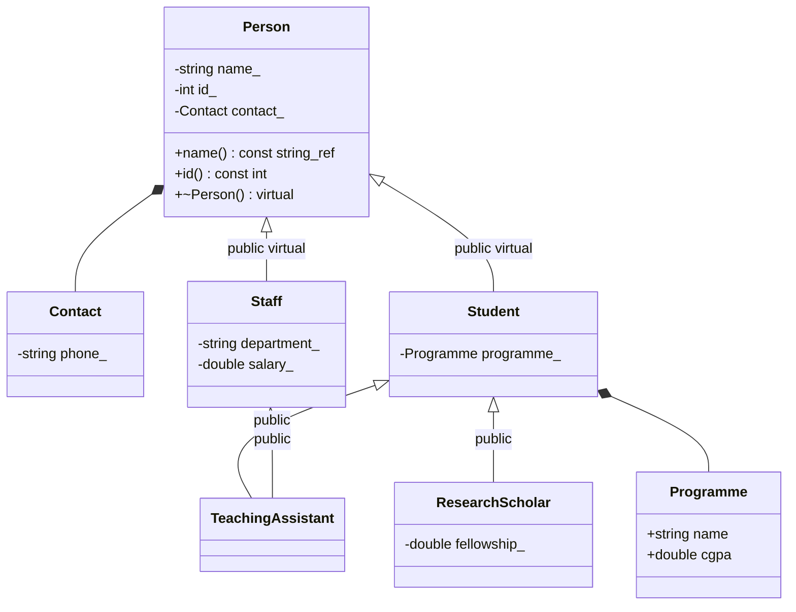

# University UML

The two virtual edges share exactly one Person within TeachingAssistant. Composition diamonds mean ownership of member objects, not inheritance.

[Standalone UML SVG](hierarchy.svg) is also provided and its rendered layout was reviewed.
