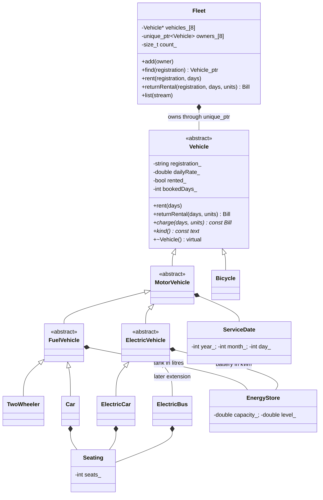

# Vehicle rental UML

Generalization arrows denote public single inheritance; composition diamonds denote owned members/objects. ElectricBus is planned here, but implemented only after the four-type baseline is committed.
